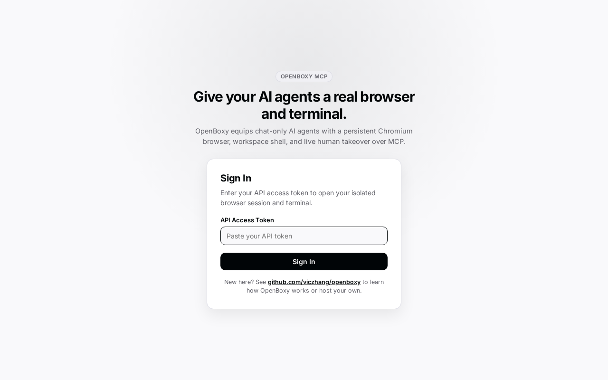
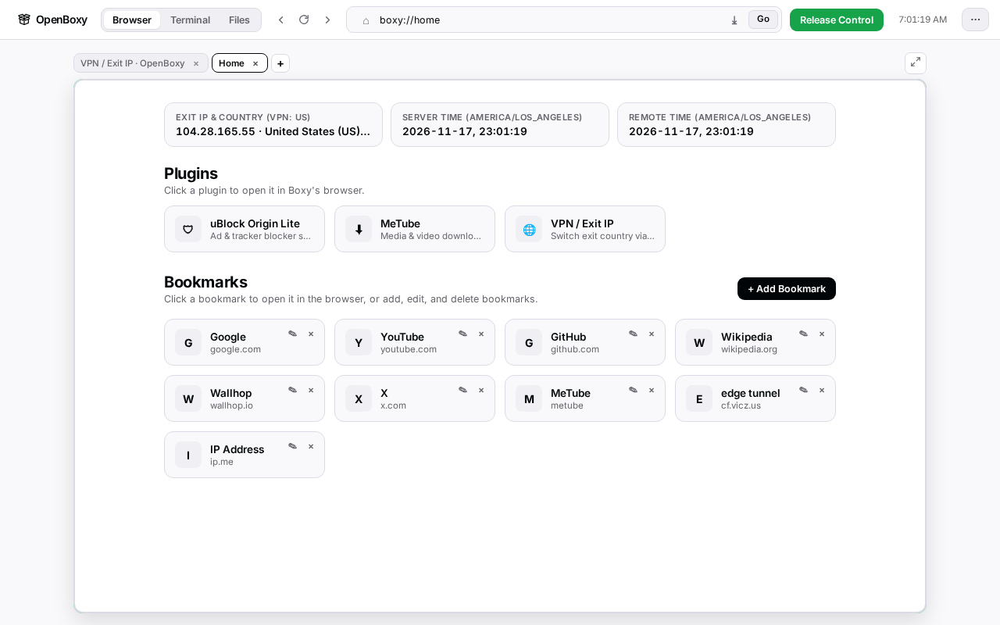
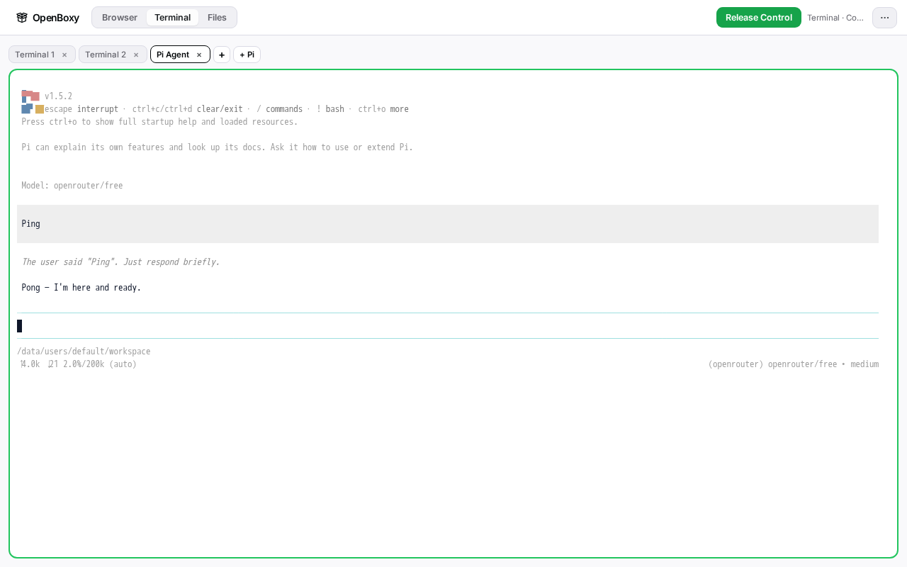
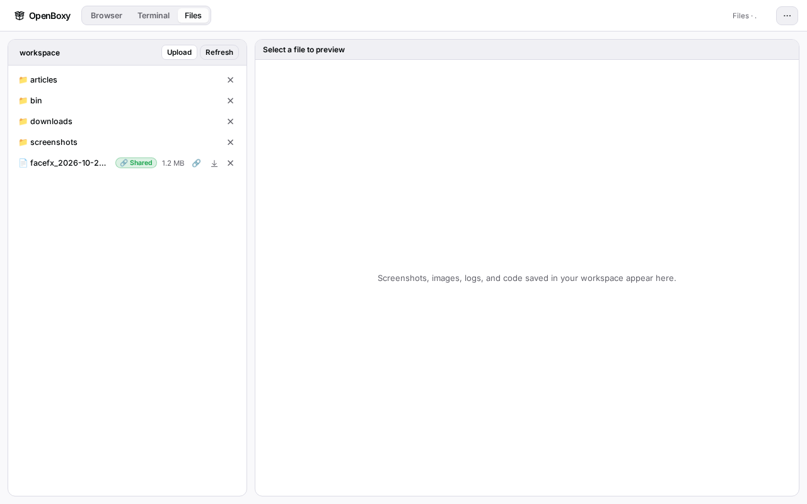

# OpenBoxy

> **Give your AI agents a real browser and terminal.**
>
> **OpenBoxy** equips chat-only AI agents with a persistent Chromium browser, workspace shell, and live human takeover over MCP—in a self-hosted, single-container **Streamable HTTP MCP server** (`/mcp`) with a live web UI (`/`, `/view`, `/view/terminal`) where you can watch or click **Take Control** to handle logins, 2FA, or CAPTCHAs by hand.

Each API token maps to an isolated user sandbox (`/data/users/<userId>/profile`, `/workspace`, and `/home`), so multiple users (or multiple AI clients) can connect safely.

---

## Features

### 1. Live Persistent Browser (`/view`) with Human Takeover
- **Real Chromium with anti-bot stealth:** Runs a persistent `patchright` Chromium context per user (`/data/users/<userId>/profile`) with uBlock Origin Lite preloaded.
- **Live Human Takeover ("Take Control"):** Watch the agent browse in real time, or click **Take Control** to pause agent actions and manually complete logins, 2FA, or interactive flows using mouse clicks, drag-selection, scrolling, keyboard shortcuts (`Ctrl/Cmd + C`, `V`, `X`, `A`), right-click context menu, and file upload dialogs.
- **Full Browser Controls:** Multi-tab bar (`+`, switch, `×`), Back / Reload / Forward buttons, URL bar with `Go` / Return-key navigation, full-screen mode, and one-click **Save Webpage to Files** (archives clean reader HTML + images into the workspace).
- **Browser Home Page (`boxy://home`):** Displays live Exit IP & Country, Server local time, and VPN remote country time on top, followed by Plugin cards and editable Bookmarks.

### 2. Multi-Tab Web Terminal & Built-in TUI AI Agent (`/view/terminal`)
- **Persistent Multi-Tab PTYs:** Open multiple `bash` tabs (`Terminal 1`, `Terminal 2`, …) that stay alive across browser refreshes with a `64 KB` scrollback buffer per tab.
- **Built-in Pi Coding Agent (`+ Pi`):** Pre-installed `@earendil-works/pi-coding-agent` (`pi`) with BYOK support (`~/.pi/agent/` stored on `/data` so API keys and sessions survive Docker image updates) and pre-wired to OpenBoxy's local `/mcp` server out of the box.

### 3. Workspace File Manager & Public Share Links (`/view/files` & `/s/<id>`)
- **Workspace Explorer:** Browse, upload, download, and delete files in `/data/users/<userId>/workspace` (including automatic browser downloads in `workspace/downloads/`).
- **Rich In-Browser Previews:** Preview images, video, markdown/code/text, and audio (with playback speed and track navigation controls).
- **Share Links (`share` tool & UI modal):** Generate public share links (`/s/<id>`) for workspace files or archived web pages with configurable expiration (`1h`, `24h`, `7d`, `never`) and optional password protection.

### 4. Streamable HTTP MCP Server (`/mcp`) & Client Setup
- **Core MCP Tools:**
  - **Browser:** `browser_navigate`, `browser_snapshot`, `browser_read`, `browser_click`, `browser_type`, `browser_press`, `browser_scroll`, `screenshot`, `browser_view`
  - **Terminal & Files:** `shell`, `read_file`, `write_file`, `edit_file`, `list_dir`, `share`
- **OAuth 2.0 PKCE & Bearer Auth:** Supports both zero-header OAuth 2.0 PKCE + Dynamic Client Registration (`/oauth/authorize`) and static `Authorization: Bearer <token>` headers, with a built-in **MCP Setup** modal in `/view` generating ready-to-paste configs for Claude Code, Codex, Gemini CLI, Cursor, OpenCode, VS Code, OpenClaw, Hermes, DeepSeek, and WorkBuddy.

### 5. Multi-User Isolation in a Single Container
- Each token (`OPENBOXY_MCP_TOKEN`, `OPENBOXY_USERS`, or `/data/users.json`) maps to an isolated user sandbox (`/data/users/<userId>/{profile,workspace,home}`) with its own browser profile, cookies, bookmarks, files, and terminal sessions.

### 6. Extensible Plugin System ([docs/plugins.md](docs/plugins.md))
- Drop `.ts` / `.js` files into `/data/plugins` to add:
  - **Custom MCP tools** (`register(ctx)`)
  - **Custom web UIs & APIs** under `/p/<pluginName>/*` (`httpHandler`)
  - **Home page cards** (`homeLink`)
  - **Browser SOCKS5/HTTP proxy routing** (`proxyUrl`, e.g. VLESS/Xray VPN exit-country switching)
  - **Unpacked Chrome extensions** (`chromeExtensionDir`)
  - **Per-user access control** (`allowedUsers`)

---

### Screenshots

**Sign In (`/login`)**



**Browser Home (`boxy://home`)**



**Multi-Tab Terminal (`/view/terminal`)**



**Workspace File Browser (`/view/files`)**



---

## Quick Start

1. **Create `.env` from the example:**
   ```bash
   cp .env.openboxy.example .env
   ```
   Generate your default API token (`OPENBOXY_MCP_TOKEN`):
   ```bash
   openssl rand -hex 32
   ```
   Optionally add more users in `.env`:
   ```env
   OPENBOXY_USERS=alice:tok_alice_xxx,bob:tok_bob_xxx
   ```

2. **Start OpenBoxy:**
   ```bash
   docker compose -f docker-compose.openboxy.yml up -d --build
   ```

3. **Verify:**
   - Health check: `curl http://127.0.0.1:3100/healthz`
   - Web UI (Browser & Terminal): `http://127.0.0.1:3100/`

---

## Connecting External AI Clients (`/mcp`)

OpenBoxy supports **OAuth 2.0 PKCE + Dynamic Client Registration** and **Static Bearer Tokens**.

### Option A: OAuth 2.0 PKCE (Recommended for OpenCode, Claude Code, Cursor)
Point your client at `https://your-domain/mcp` with no manual headers. In **OpenCode** (`~/.config/opencode/opencode.jsonc`):

```jsonc
{
  "mcp": {
    "boxy": {
      "type": "remote",
      "url": "https://your-domain/mcp",
      "enabled": true
    }
  }
}
```

Then run `/mcps` in OpenCode, select `boxy`, and sign in at `/oauth/authorize` using your API token. Your OAuth session is bound to that token's user sandbox.

### Option B: Static Bearer Token
```json
{
  "mcpServers": {
    "boxy": {
      "serverUrl": "https://your-domain/mcp",
      "headers": {
        "Authorization": "Bearer YOUR_API_TOKEN"
      }
    }
  }
}
```

---

## Exposed MCP Tools
- **Terminal & Files:** `shell`, `read_file`, `write_file`, `edit_file`, `list_dir`
- **Browser:** `browser_navigate`, `browser_snapshot`, `browser_read`, `browser_click`, `browser_type`, `browser_press`, `browser_scroll`, `screenshot`, `browser_view`
- **Browser Downloads:** Any file downloaded in the live browser automatically saves to `workspace/downloads/` and appears in `/view/files`.

---

## Plugins (Custom Tools & Extensions)

Drop `.ts` / `.js` plugin files into `/data/plugins` (or set `OPENBOXY_PLUGINS_DIR`) to register custom MCP tools, web UIs (`/p/<name>`), home page cards, browser proxies, or unpacked Chrome extensions without modifying OpenBoxy core. See **[docs/plugins.md](docs/plugins.md)** for the full plugin authoring guide.

```ts
import type { OpenBoxyPlugin } from "/app/src/plugins.ts";

export default {
  name: "my-custom-tool",
  // Optional: restrict to specific userIds
  // allowedUsers: ["default"],
  register(ctx) {
    ctx.registerTool(
      "open_my_app",
      {
        description: "Open my internal web app and prefill an input.",
        inputSchema: { query: ctx.z.string() },
      },
      async ({ query }) => {
        await ctx.sandbox.withPage(ctx.userId, async (page) => {
          await page.goto("http://my-service:8080");
          // ...prefill page...
        });
        return ctx.textResult({
          viewUrl: `${ctx.publicUrl}/view`,
          filesUrl: `${ctx.publicUrl}/view/files`,
        });
      },
    );
  },
} satisfies OpenBoxyPlugin;
```
